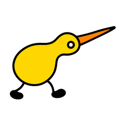
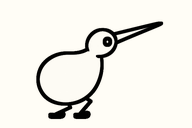

# RunnerDuck

A duck that walks by default and runs as CPU load rises. RunnerDuck keeps system metrics, AI usage monitoring, widgets, and custom runners on Windows and macOS.





The built-in runners are **Duck** (`duck`), whose outline follows the system theme, and **Duck (White)** (`duck-filled`), with a white body and black outline. Both walk by default and share the same load-driven animation. Select either runner from the runner menu on Windows or macOS. The app icon is yellow. Generated poses and in-betweens are bundled locally. No image generation happens while the app runs.

## Install with one command

Open a terminal in the cloned repository or extracted Windows offline ZIP.

**Windows:**

```powershell
pwsh -File ./install.ps1
```

Choose **1. Widget + Tray**, **2. Widget only**, or **3. Tray only**. The installer prepares missing build tools, installs the app, and starts the tray when selected. **Tray only needs no Developer Mode or administrator permission.** Widget modes enable Developer Mode automatically; approve the Windows administrator prompt if shown. Add the widget through **Win+W** after installation (Windows 11 required).

The offline ZIP uses the same command and includes all app runtimes. If `pwsh` is not installed, double-click **install.cmd** instead. AI usage refresh requires internet access even when installation is offline.

**macOS:**

```sh
bash ./install.sh
```

The installers use your local files; manage cloning and Git updates separately. Windows source builds need internet access on first use; offline ZIP installation does not. See [Windows installation details](docs/WindowsInstallation.md) for optional flags, offline ZIP creation, and installation locations.

### macOS prerequisites and installation

- macOS 26 or later, plus any newer OS version required by your selected Xcode release.
- Full Xcode with Swift 6.2 or later and a compatible macOS SDK. See [Xcode system requirements](https://developer.apple.com/xcode/system-requirements).
- Open Xcode once and complete its first-launch setup before installing RunnerDuck.

Check the selected tools:

```sh
xcodebuild -version
xcrun swift --version
```

The installer builds the app and its widget and installs `~/Applications/RunnerDuck.app`. Settings are preserved when updating.

RunnerDuck starts in the menu bar. The widget can be selected from macOS's widget gallery after installation.

### Installer options

Run these commands from the repository root:

| Purpose | Windows | macOS |
| --- | --- | --- |
| Build, install, and launch | `pwsh -File ./install.ps1` | `bash ./install.sh` |
| Build and install without launching the app | `pwsh -File ./install.ps1 -NoLaunch` | `bash ./install.sh --no-launch` |
| Select components without a prompt | `pwsh -File ./install.ps1 -InstallMode Both` (or `Widget`, `Tray`) | Not applicable |
| Explicitly choose the Windows architecture | `pwsh -File ./install.ps1 -Platform x64` or `-Platform ARM64` | Selected by Xcode |

For Windows, choose the architecture matching your machine or leave `-Platform` unset. The root PowerShell script delegates to [Windows/Install-RunnerDuck.ps1](Windows/Install-RunnerDuck.ps1). The macOS installer is [install.sh](install.sh).

RunnerDuck launches at login by default. You can turn this off in **Settings > General**.

### Update or reinstall

Check for a new version in **Settings > General > App updates**. To update, pull the latest source and run the installation command again. Settings are kept.

```sh
git pull --ff-only
```

To reinstall the current version, run the installer without pulling. For a Windows offline installation, run the installer from a new offline ZIP.

### Installed files and data

| Platform | App installation | Settings and data |
| --- | --- | --- |
| Windows widgets | New installs: `%LOCALAPPDATA%\RunnerDuck\App`. Updates: existing package location. | `%LOCALAPPDATA%\Packages\<PackageFamilyName>\LocalState` |
| Windows tray only | `%LOCALAPPDATA%\RunnerDuck\TrayApp` | `%LOCALAPPDATA%\RunnerDuck` |
| macOS | `~/Applications/RunnerDuck.app` | `~/Library/Application Support/RunnerDuck` and the `io.github.duks93.RunnerDuck` defaults domain |

`<PackageFamilyName>` is a placeholder; use the package status command below to find its value. For unpackaged Windows development runs, data falls back to `%LOCALAPPDATA%\RunnerDuck`.

### Troubleshooting

| Symptom | What to check |
| --- | --- |
| `install.ps1` or `install.sh` cannot be found | Open a terminal in the cloned repository root, where both files are present. |
| `pwsh` cannot be found | Double-click `install.cmd`. Missing .NET SDK is prepared automatically for source builds. |
| Windows administrator prompt appears | Widget modes enable Developer Mode automatically. Approve the prompt, or select Tray to install without it. |
| Windows package registration or widget addition fails | Check the registered package and its logs below. Include the command's error output when reporting a failure. |
| `xcodebuild` cannot find a usable Xcode | Complete Xcode setup and select the full Xcode installation as shown below. |
| A build fails while restoring packages | Check internet access and the dependency error in the build output, then rerun the installer. |
| macOS build fails | Read `artifacts/mac-build.log` in the repository. The installer also prints the last 80 log lines on failure. |

Check the Windows package from PowerShell 7:

```powershell
Import-Module Appx -UseWindowsPowerShell -WarningAction SilentlyContinue
Get-AppxPackage -Name RunnerDuck | Select-Object Name, PackageFamilyName, InstallLocation, Status
```

A registered package should show `Status` as `Ok`. App diagnostics are in `App.log` under the package's `LocalState` directory. Widget diagnostics use `Widget.log` in the same directory once the widget provider runs and writes a log. Include these logs and the package status when diagnosing a widget that appears in the gallery but cannot be added.

If macOS selects Command Line Tools instead of full Xcode, select your installed Xcode bundle. For an installation at `/Applications/Xcode.app`:

```sh
sudo xcode-select --switch /Applications/Xcode.app/Contents/Developer
```

Adjust the path if your Xcode app has another name, then retry `bash ./install.sh`.

## Build without installing

Use these commands from the repository root when you only need build output. Use the installer above when you want the app installed with its widget components.

**Windows (x64 Release):**

```powershell
dotnet build Windows/RunnerDuck.Desktop -c Release -p:Platform=x64 -p:WindowsAppSDKSelfContained=true
```

Use `-p:Platform=ARM64` for ARM64. Output is under `Windows/RunnerDuck.Desktop/bin/<Platform>/Release/net10.0-windows10.0.19041.0/`. A build alone does not register the package or widget provider.

**macOS (Release with ad-hoc signing):**

```sh
xcodebuild build -project RunnerDuck.xcodeproj -scheme RunnerDuck \
  -configuration Release -derivedDataPath artifacts/mac-build.noindex \
  -skipPackagePluginValidation CODE_SIGN_IDENTITY=- CODE_SIGN_STYLE=Manual DEVELOPMENT_TEAM=
```

The app, including its widget extension, is written to `artifacts/mac-build.noindex/Build/Products/Release/RunnerDuck.app`.

## Development checks

Run the Windows unit tests from the repository root:

```powershell
dotnet test Windows/RunnerDuck.Core.Tests -c Release
dotnet test Windows/RunnerDuck.AIUsage.Tests -c Release
dotnet test Windows/RunnerDuck.App.Tests -c Release
```

Run the macOS package tests:

```sh
cd LocalPackage
xcodebuild test -scheme LocalPackage-Package -destination 'platform=macOS' \
  -derivedDataPath ../artifacts/mac-tests -skipPackagePluginValidation CODE_SIGNING_ALLOWED=NO
```

## Behavior and data

Choose **Small**, **Standard**, or **Large** under **Settings > Runner > Appearance > Runner size** on either platform. Changes apply immediately and are saved across restarts. macOS uses 14, 18, or 22 point menu bar images. Windows uses 75%, 100%, or 125% zoom inside the system's fixed tray icon area; Large can crop the edges, and the settings preview shows that crop.

The duck walks by default, including before the first CPU sample and at low CPU load. CPU load is smoothed with a two-second time constant. Run starts at 60% and returns to walk at 55%. State changes wait for a connecting pose and play a 300ms transition. The reverse-load setting applies to both states and playback speed.

- [Custom runners](docs/CustomRunners.md)
- [Custom metrics schema and examples](docs/CustomMetricsSchema.md)
- [Animation assets and reproduction](artwork/duck/README.md)
- [Architecture](ARCHITECTURE.md), [contributing](CONTRIBUTING.md), [privacy](docs/privacy_policy.md)

## License

Apache-2.0. Reused code attribution, copyright notices, and modification history are in [NOTICE](NOTICE) and [LICENSE](LICENSE). Full dependency notices are bundled in both apps' Open Source License windows and in [Legal](LocalPackage/Sources/UserInterface/Resources/Legal). Original built-in character art and promotional assets are excluded.
